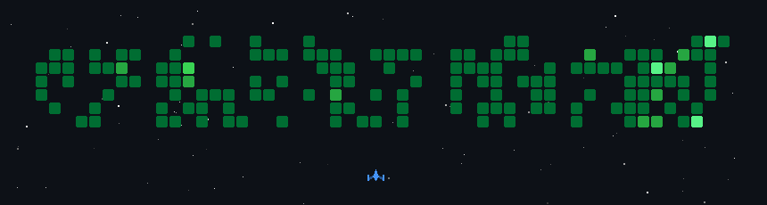

# Hi, I'm Arafat Mannan

### Software Engineer

I enjoy focused, independent work and prefer clear, proven approaches to building software.  
Always learning — aiming to be a steady, well-rounded contributor over the long run.

 

---

### Contribution space shooter

*My commits as enemies — a spaceship clears the year, one contribution at a time.*

---

### About me

- Prefer deep focus and thoughtful problem-solving over noise
- Value clean architecture, readable code, and reliable delivery
- Comfortable across the stack — frontend, backend, and infrastructure
- Continuously improving through practice, projects, and consistent learning

---

### Tech stack

<b>Languages</b>

 

<b>Frontend</b>

 

<b>Backend</b>

 

<b>Databases & ORM</b>

 

<b>DevOps & Tools</b>

 

---

### GitHub stats

 

 

---

### Practice & consistency

---

  

